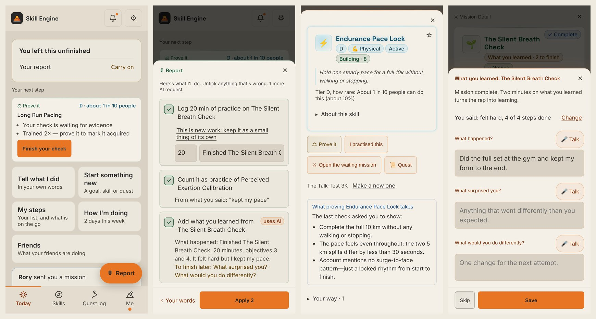
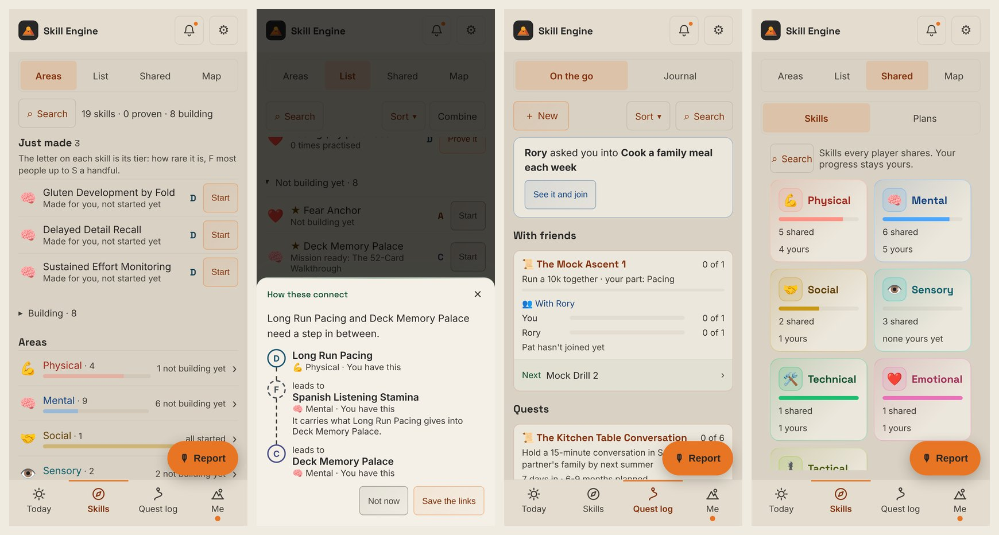

# Skill Engine

  

**A real-life RPG where you are the character.** Skill Engine maps real human abilities as a graph,
writes missions that train them and quest arcs that chain them, and keeps track of what you have
actually practised and proven. Rank means you can do the thing, not that you ticked a box often.

The idea began in a notebook in March 2024 and has been rebuilt several times since, on Android,
React Native, Flutter and Expo, as Will learned each stack. This is the current version, started in
September 2026.

## How it works

- **Skills are a graph of real abilities.** Each skill is rated by how rare it is (F, most people,
  to S, a handful) and linked to others by what it builds on, what it leads to and what it shares.
  Skills that players make go into a shared library that every player can draw from.
- **Missions are training plans** attached to that graph: steps, the skills they train, and what
  comes next. After a finished mission the app offers *go further* (the bar raised) or *go
  differently* (a new way in).
- **Proving a skill is a real bar.** A skill check asks for evidence, and an AI examiner judges it
  against what the skill says. Only then is the skill marked acquired.
- **Tell it what you did, in your own words.** Type or speak a few lines, and the app sorts them
  into logged practice, finished steps and new skills, and shows you each change before it is saved.
- **Action, then reflection.** Every finished mission ends with a short debrief: what happened, what
  surprised you, what you would change.
- **Friends and quests.** Send a friend a mission, or ask them into a quest you run together.

  

## How it is built

- **TypeScript monorepo:** a Fastify server and a React web app that installs on a phone as a PWA.
  The server owns every prompt, model call, check and write; the app only talks to the API and
  holds no keys.
- **No single AI vendor.** Every model call goes through one provider interface: Claude through the
  Anthropic API, or any OpenAI-compatible host (open-weight models such as DeepSeek). Each task can
  be routed to a different model. Every answer is checked against a schema on the server before it
  is used, and a mock provider runs the whole app offline at no cost.
- **Measured, not guessed.** A check script runs every AI task once against a chosen model and
  reports what passed, the tokens used and the cost of each step, so switching models is a change
  of settings backed by numbers.
- **Each player owns their data:** one SQLite file per player, exportable whole. Every change is
  written to an append-only event log.
- **Runs on Google Cloud Run** from one Docker image, scaling to zero, with each player's file kept
  in a private Cloud Storage bucket. Testers get access codes; reminders arrive by Web Push; voice
  notes are transcribed and the audio is not kept.
- **Tested at real phone sizes.** A script drives the built app with a made-up player and
  screenshots every screen at seven phone widths, then reports anything that does not fit. The
  pictures on this page come from it.
- **Decisions are written down.** More than 380 dated design decisions, a data protection impact
  assessment and a breach plan sit alongside the code.

## Where it is

In a closed test with a small group of testers. The core loop (skill, mission,
finish, reflect, skill check, acquired, character sheet) works end to end, along with friends,
shared skills, quests, voice notes and reminders.

## How it was made

Designed and built by Will Douglas, with an AI coding assistant (Claude Code) as a pair programmer
for much of the code and the documents. In the app, AI writes missions, quests and skill links,
sorts what you tell it, and examines skill checks; every AI answer is checked against a schema
before the app uses it.

## What is in this repository

This is the project's public face, not its source. It holds this page, its pictures and the
licence. The code, the prompts and the design documents are kept in a private repository. All
rights are reserved; see [LICENSE](LICENSE).

This repository is written by a publish step from the private one; changes made here directly are
overwritten.
